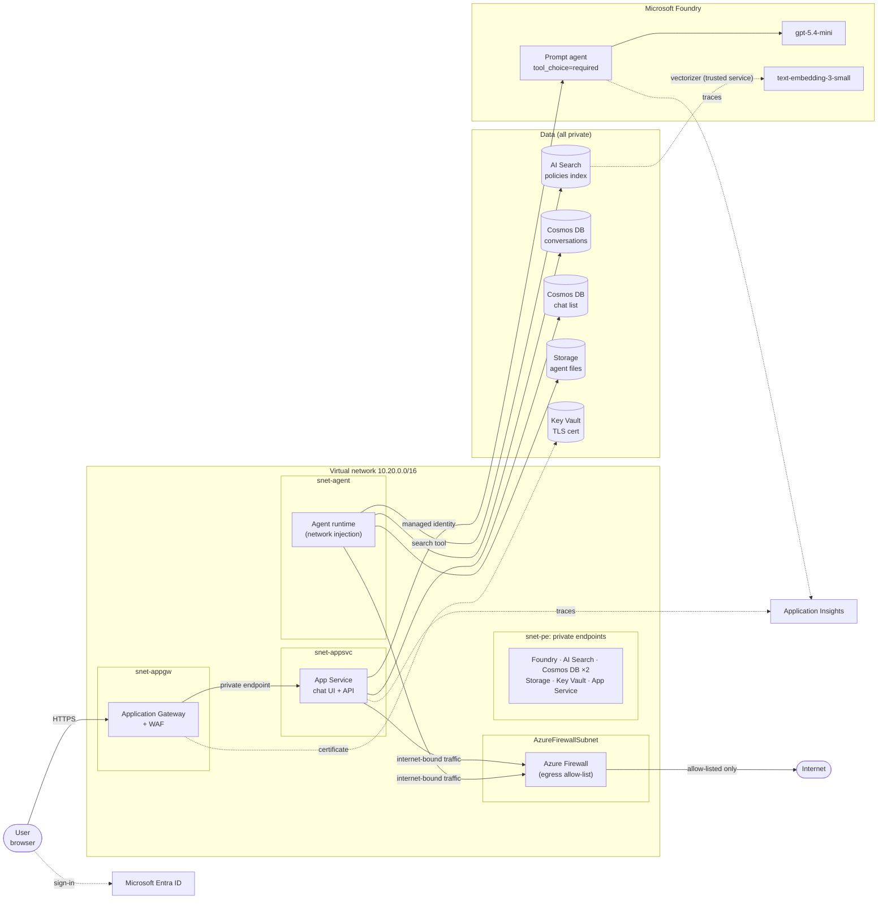

# Architecture: a private, grounded chat agent on Microsoft Foundry

A working implementation of most of the
[Baseline Microsoft Foundry chat reference architecture](https://learn.microsoft.com/azure/architecture/ai-ml/architecture/baseline-microsoft-foundry-chat)
([reference diagram](chatbot-architecture.jpg)), built **one step at a time** so each piece can be understood
on its own. Everything is defined in [`infra/main.bicep`](infra/main.bicep).

- **How to run it and the experiments:** [README.md](README.md)
- **Why each choice was made, and what we measured:** [STACK.md](STACK.md)

## The picture

Arrows into the data stores go through the private endpoints in `snet-pe`. Nothing in the
"Data" box or in Foundry accepts traffic from the internet.

## One message, end to end

1. The browser connects to the **Application Gateway**. The **WAF** inspects the request (SQL injection,
   XSS and similar attacks get a `403`), then the gateway forwards it to the app's **private endpoint**.
   The app's own public URL is closed.
2. **App Service authentication** signs the user in with **Entra ID** (only assigned users), and the app
   checks the user owns the conversation they're resuming.
3. The app calls the **Foundry agent** with its **managed identity**: no keys anywhere.
4. The agent **must** search (`tool_choice=required`). Its runtime sits **inside our VNet** and queries
   **AI Search** through a private endpoint. Search embeds the question by calling the embedding model.
5. The **model** answers from the retrieved policy sections, with citations.
6. Foundry stores the conversation in **our Cosmos DB**. The app adds it to the user's chat list in a
   second Cosmos DB.
7. Anything heading for the internet (sign-in tokens, telemetry) leaves through the **firewall**, which
   allows only listed destinations and logs every attempt.
8. Both the app and Foundry send traces to **Application Insights**, so one request can be followed
   across all of these hops.

## Two locks on every door

| Layer | What it checks | Built in |
|---|---|---|
| **Identity** | Who are you, and which role do you have? (Entra ID, managed identities, RBAC, no API keys) | steps 1–3b |
| **Network** | Can you even reach it? (private endpoints, public access off, NSGs, firewall, WAF) | steps 5–6b |

A request needs both. A leaked token is useless from the internet, and being inside the network
doesn't grant access without the right role.

## Coverage of the reference diagram

| Reference diagram component | Status | Step |
|---|---|---|
| Foundry account, project, prompt agent, model, managed identities | ✅ built | 1, 4 |
| AI Search knowledge store (agent tool) | ✅ built | 2 |
| App Service chat UI + managed identity | ✅ built | 3 |
| Application Insights / Azure Monitor | ✅ built | 3 |
| Microsoft Entra ID (users + workloads) | ✅ built | 3b |
| Foundry Agent Service dependencies: Cosmos DB, Storage, AI Search | ✅ built (⚠️ AI Search shared with the knowledge index) | 4 |
| Virtual network, private endpoints, private DNS zones | ✅ built | 5 |
| Agent integration subnet (network injection) | ✅ built | 5 |
| Azure Firewall + egress allow-list | ✅ built, **switched off between sessions** (cost) | 6a |
| Application Gateway + WAF, Key Vault for the TLS certificate | ✅ built, can be switched off (cost) | 6b |
| NSGs on subnets | ✅ built | 6b |
| App Service across **3 availability zones** | ❌ single B1 instance | 7 |
| **Azure Bastion + jump box** (private operator access) | ❌ not yet | 7 |
| **Build agents** subnet (deploy from inside the network) | ❌ not yet. The SCM site stays public for deploys. | 7 |
| **Storage for client app deployment** (run-from-package) | ❌ zip deploy with an on-server build instead | 7 |
| **DDoS Protection** plan | ❌ not enabled (default infrastructure protection only) | 7 |
| **Internet sources** (web search tool through the firewall) | ❌ no internet tool on the agent | — |
| Custom domain + CA-issued certificate | ❌ self-signed certificate on the gateway's `cloudapp.azure.com` name | — |

The remaining gaps are mostly about **operations and availability** (private admin access, zone
redundancy, CI/CD inside the network), not about how a chat request flows.

## Deviations from the baseline (on purpose)

- **One AI Search service** for both the knowledge index and Foundry's internal vector stores (saves about $80/month).
- **Search → embedding model** uses Foundry's *trusted Azure services* exception: Search Basic can't use a
  shared private link to Foundry.
- **Basic firewall** instead of Standard, and **switchable** firewall and gateway, so the demo is affordable to run.
- **Learning-friendly endpoints:** `/healthz/deps` and `/healthz/egress` let you check the private path and
  the firewall without signing in. They return true/false only, and egress goes to a fixed target.

## What it costs

About **$135/month** for the always-on core (AI Search Basic, App Service B1, private endpoints), plus about
**$0.40/hour** for the firewall and **$0.45/hour** for the Application Gateway while they're deployed.
Prices are Sweden Central retail, checked 2026-11; see [STACK.md](STACK.md) and the README's *Cleanup* section.
