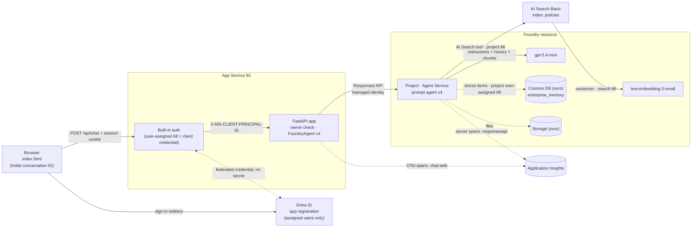

# STACK: basic chatbot, steps 1–5

## Problem and scope

**Goal:** build the [baseline Microsoft Foundry chat reference architecture](https://learn.microsoft.com/azure/architecture/ai-ml/architecture/baseline-microsoft-foundry-chat)
([diagram](chatbot-architecture.jpg)) in increments, understanding each component before adding the next.

| Step | Question it answers |
|---|---|
| 1 | What's the minimum that turns a user message into an agent answer? What's mine vs Foundry's? |
| 2 | What does grounding in company documents take, and how reliably does a prompt agent use retrieval? |
| 3 | How does a hosted app call the agent without secrets, and can one request be traced across app and Foundry? |
| 3b | How do end users sign in without the app holding a secret, and how do we stop one user reading another's conversation? |
| 4 | What does it take for agent state to live in resources *we* own, and what does it cost? |
| 5 | Can everything except the web app be unreachable from the internet, and what does that change? |

**Assumptions:** a learning build, a 16-chunk synthetic corpus, public endpoints secured by Entra ID. **Decisions made:** Bicep · Agent Framework `FoundryAgent` · Sweden Central ·
Azure AI Search tool (not Foundry IQ) · AI Search Basic with hybrid vectors · **forced retrieval
(`tool_choice=required`, agent v4)** · FastAPI on App Service B1 · **App Service built-in auth with a
federated credential (no secret), assigned users only, ownership in conversation metadata** ·
**standard setup in a new project via capability hosts (GA, as in the baseline repo), serverless Cosmos DB,
search service shared between knowledge and agent vector store (deviation)** · **step 5: VNet + private endpoints +
private DNS, network-injected agent in a NEW Foundry resource (old one deleted), public access off everywhere
except the web app, no IP exceptions, Search→Foundry via the trusted-services exception**.

## How it works



**One turn through the web app:**
0. **Sign-in (once per session):** App Service redirects the browser to Entra ID. Entra refuses unassigned users (`appRoleAssignmentRequired`). On the callback, App Service redeems the code by presenting a token from its **user-assigned managed identity** (a federated credential) instead of a client secret, then sets a session cookie.
1. The browser posts `{message, conversation_id}` with the cookie. App Service validates the session and adds `X-MS-CLIENT-PRINCIPAL-ID/NAME` headers, which external callers can't set. The app reads the user's **object ID**.
1b. **Authorization:** a new conversation is created with metadata `owner_oid = <user oid>`. Resuming one retrieves it and checks `owner_oid`. A mismatch, missing or malformed ID gets `404`.
2. The app gets a token for its **system-assigned managed identity** (`GET /msi/token`) and calls the Responses API with the agent reference (name + version 4).
3. Agent Service loads v4. `tool_choice=required` means **the model must call the search tool**: it writes a query, and AI Search runs hybrid + semantic retrieval (project MI → Search, search MI → embeddings).
4. The model answers from the chunks with citations. The call, the chunks and the answer are stored in the conversation.
5. The app extracts the search queries and citation titles from the raw response and returns them to the UI.
6. Telemetry: the app sends `chat-web` spans with OpenTelemetry. Foundry sends `responsesapi` spans (e.g. `invoke_agent basic-chatbot:4`) through the project's App Insights connection.

### Network (step 5)

```
                     Internet
                        │ HTTPS (inbound still public; step 6: App Gateway + WAF)
                        ▼
              App Service (web app) ── outbound via VNet integration (route all)
                        │
VNet 10.20.0.0/16 ──────┼────────────────────────────────────────────────────────────
  snet-appsvc 10.20.2.0/26 (delegated: Microsoft.Web/serverFarms)
                        │
  snet-pe 10.20.1.0/24  ▼
     10.20.1.12 ─Private Link─▶ Foundry (fdy-chatbot-vnet-…)   ◀── project, agent, models
     10.20.1.9  ─Private Link─▶ AI Search  ◀────────────────┐
     10.20.1.5  ─Private Link─▶ Cosmos DB (agent state)  ◀──┤
     10.20.1.7  ─Private Link─▶ Cosmos DB (app sessions)    │ agent's calls start inside the VNet
     10.20.1.4  ─Private Link─▶ Storage (blob)  ◀───────────┤
  snet-agent 10.20.0.0/24 (delegated: Microsoft.App/environments)
     Foundry agent runtime (network injection) ─────────────┘
  6 private DNS zones (privatelink.*) linked to the VNet
───────────────────────────────────────────────────────────────────────────────────────
  Search ──(trusted Azure services exception, MI + RBAC)──▶ Foundry embedding model
  Public network access: Disabled on Foundry, Search, Cosmos ×2, Storage
```

## Why this stack

| Component | Role in this demo | Why chosen | Tradeoff / alternative |
|---|---|---|---|
| **Foundry resource + project** | Hosts agents, models, conversations, connections | Required for Agent Service | The project identity is what tools use. One project per isolation boundary. |
| **Prompt agent, `tool_choice=required`** | Declarative agent that must retrieve | Measured: `auto` skipped search on 4/20 policy questions | +~540 tokens and +1 s on non-policy turns. A *hosted agent* would give code-level control (search only when relevant). |
| **Standard agent setup** (step 4) | Conversations + agent definitions in **our Cosmos DB**, files in **our Storage**, vectors in **our Search** | Data ownership: backup, retention, CMK, audit, residency are ours | Basic setup: zero resources, but no control or visibility |
| **Capability hosts** (account + project, API 2025-06-01) | Tell Agent Service which connections hold state | GA, and what the baseline repo uses | *Capability settings* (newer, `2026-07-15-preview`, provisioned by the caller instead of the project identity) |
| **New project** for standard setup | Required | A project's storage can't be changed after creation | n/a. Plan the setup before the first real conversation. |
| **User-assigned identity for the project** | Runtime + provisioning identity | Exists *before* the project, so roles can be granted before provisioning | System-assigned (template 41): works, but needs careful ordering |
| **Cosmos DB serverless** | Thread storage | ~$0 idle | Provisioned ≥3000 RU/s for predictable latency (~$175/month). Zone redundancy and continuous backup for production. |
| **App-owned sessions index** (separate serverless Cosmos, `/user_oid` partition) | "Your chats" list and reopen | Our schema for our feature. Never depend on Foundry's internal containers. Per-user partition = isolation by construction. | Foundry has no "list conversations by owner" query, so without this the UI can't list chats |
| **VNet + private endpoints + private DNS** (step 5) | Second security layer: no internet path to data services | Independent of identity: a leaked token or over-broad role is no longer usable from the internet | Network security perimeter (preview); IP allow-lists (rejected: user wanted no IP exceptions) |
| **Network injection** (agent subnet) | Agent's outbound calls start inside our VNet | Required for private Search/Cosmos/Storage with Foundry Agent Service | Microsoft-managed network (less control); not possible on an existing account |
| **New Foundry resource** for step 5 | Network injection must exist from creation | No supported way to add it to the step 1–4 account | n/a. Decide on networking before the first production agent. |
| **Two-phase rollout** (`lockDown` param) | Build and migrate with public access on, then close it | Lets local tools finish setup (agent, index) before we lose access | Build from inside the VNet (jump box/CI runner, step 7) |
| **Trusted-services exception for Search → Foundry** | Vectorizer reaches the embedding model | Search Basic can't do a shared private link to Foundry; Microsoft's own private Foundry IQ tutorial relies on this bypass | Search S1 (~$245/month) with a shared private link; or non-vector query types |
| **Default outbound access on agent/app subnets** | Egress to Entra ID and App Insights | New subnets are private by default | NAT Gateway, or Azure Firewall with FQDN rules (step 6) |
| **One search service for knowledge *and* agent vectors** | Cost saving | ~$80/month less | **Deviation:** the baseline uses a dedicated one, so a compromise of one use doesn't expose the other. Split before production. |
| **gpt-5.4-mini**, 50K TPM | Generation + tool use | Agent-supported, cheap. 10K TPM caused 429s with grounding. | Larger models: maybe fewer skipped searches under `auto` (untested) |
| **Azure AI Search tool** | Single-index retrieval | In the reference, and transparent | Foundry IQ for multi-source agentic retrieval |
| **AI Search Basic, hybrid + semantic** | Index + vectorizer | Cheapest tier with an outbound MI (keyless vectorizer) | Free tier: keyword + semantic only |
| **text-embedding-3-small**, section chunks | Embeddings, chunking | Cheap. Policies are naturally sectioned. | `-3-large`, overlapping chunks for long documents |
| **FastAPI on App Service B1 (Linux, Py 3.14)** | Chat API + static page | Smallest hosted tier, ~$0.018/h. Zip deploy + Oryx build, no container. | Container Apps; P0v3+ for zone redundancy (the diagram's 3 instances) |
| **System-assigned managed identity** | App → Foundry auth | No secrets. Same RBAC as a user. | User-assigned MI if several apps share one identity |
| **Conversation ID in the browser** | Session continuity | Keeps the server stateless (restarts and scale-out are safe) | Safe only with the owner check below |
| **App Service built-in auth (Easy Auth)** | End-user sign-in before code runs | No auth code to write or get wrong. Identity headers are unforgeable. | MSAL in app code for custom flows. API Management / App Gateway auth at the edge later. |
| **Federated credential on a user-assigned MI** | The app registration's credential | No client secret to store, rotate or leak. Keeps the "no secrets" property end to end. | Client secret in Key Vault (simpler and very common, but a secret) |
| **Assignment required on the service principal** | Who may sign in | Entra enforces it before App Service is reached | Group-based assignment for real users. App roles for coarse authorization. |
| **Owner object ID in Foundry conversation metadata** | Per-conversation authorization | No extra database. Metadata survives turns (tested). | A sessions table (Cosmos DB, step 4) if you need listing or sharing. One extra Foundry call per turn. |
| **Microsoft Graph Bicep extension** | Entra objects in the same IaC | One deployment for Azure *and* Entra. Repeatable. | `az ad` scripts. Entra objects outlive the resource group, so delete them separately. |
| **Application Insights (workspace-based)** | Client + server traces | Foundry's server-side tracing needs it, and the app can use the same resource | Entra-only ingestion (connection string today) |
| **Agent Framework `FoundryAgent`** | Runtime client | [Reference's choice](https://learn.microsoft.com/agent-framework/integrations/by-component/agent-services/foundry). Ignores client `tool_choice` for prompt agents, so it's set on the agent. | Raw `azure-ai-projects` |
| **Bicep** | IaC | Azure-native, matches the reference implementation | Terraform + azapi |

## What the demo showed

**Step 1 (2026-11-15):** memory works within a conversation, survives a process restart via the
conversation ID, and is absent across `/new`. Input tokens grow every turn.

**Step 2 (2026-11-16):**

| Observation | Evidence | Implication |
|---|---|---|
| **The AI Search tool authenticates as the *project* identity**, not the account identity the [tool doc](https://learn.microsoft.com/azure/foundry/agents/how-to/tools/ai-search#setup) says | Project MI with *Index Data Reader* only → `400 tool_user_error`. + *Search Service Contributor* → works. Account MI roles removed → still works. | Grant roles to the project MI. *Search Service Contributor* is over-privileged, so a custom role is a TODO. **Sources disagree; this is what we observed.** |
| **Under `auto`, the model sometimes skips search** | Run A: hotel 3/4, receipt 1/4 searched. Run B (`evaluate.py`): 12/12. Overall **16/20**. A skip gives "couldn't find it". | Intermittent and not predictable from the question |
| **`required` fixes it, at a fixed cost** | v4: 12/12 policy searched, 12/12 correct. "Capital of Sweden": 1277 vs 738 input tokens, 2.2 s vs 1.1 s. Missing topic: both versions correctly decline (3/3). | **Decision: pin v4.** For a policy assistant, reliability is worth the small-talk overhead. |
| Retrieved chunks persist in the conversation | v2 follow-ups answered uncited from earlier chunks. v4 follow-ups search again and cite, but input tokens grow faster (1256 → 2359 on turn 2). | Forced search trades token growth for traceable answers |
| Citations carry the chunk title but not our `url` field | The annotation URL is the search endpoint | Unresolved |

**Step 3 (2026-11-16):**

| Observation | Evidence | Implication |
|---|---|---|
| The app reaches Foundry with **only** its managed identity | App settings contain endpoints and the agent name/version, no keys. App Insights shows `GET /msi/token` from `chat-web`, then the Foundry calls. Grounded answers work in the deployed app. | The same pattern carries into step 5, which adds a private endpoint in front |
| **One request = one end-to-end trace across app and Foundry** | Same `operation_Id`: `chat-web` POST /api/chat → POST …/responses → `responsesapi` `invoke_agent basic-chatbot:4` → `execute_tool remote_functions.azure_ai_search` (216–808 ms) → `chat gpt-5.4-mini` | Trace context propagates from the app into Foundry. "Why was this answer slow or wrong?" can be answered per request. |
| Cold start is dominated by identity | First request 7.9 s, of which `GET /msi/token` took 3.8 s. Warm requests 1.7–2.3 s. | Warm the token at startup, or accept it. Tokens are cached for subsequent calls. |
| Account- and project-level connections share a namespace | Deploy failed: `Connection appinsights already exist` | Use different names (the sample does) |
| `az webapp deploy --track-status` can hang after success | The CLI ran >10 min while the deployment log showed success and `/healthz` was 200 | Verify with the deployment log + health check, not the CLI exit |
| Local and hosted code are identical | Same `app/main.py`. The credential switches on `WEBSITE_SITE_NAME` (CLI locally, MI in Azure). | No `DefaultAzureCredential` probing in Azure |

**Step 3b (2026-11-17):**

| Observation | Evidence | Implication |
|---|---|---|
| Sign-in works with **no secret anywhere** | App registration has 0 password credentials, 1 federated credential (subject = auth MI). Auth setting `clientSecretSettingName = OVERRIDE_USE_MI_FIC_ASSERTION_CLIENTID`. Browser request → 302 to `login.microsoftonline.com/<tenant>/oauth2/v2.0/authorize`, `response_type=code id_token`. | Credential lifecycle disappears (nothing expires or rotates) |
| **Identity headers can't be forged** | Anonymous `POST /api/chat` with a real object ID in `X-MS-CLIENT-PRINCIPAL-ID` → `401`. `/healthz` (excluded) → `200`. | Trusting the headers in app code is safe *behind* built-in auth. The app also fails closed if they're missing. |
| **Ownership check blocks cross-user access** | Local, two simulated users: Alice resumes her conversation (200). Bob with Alice's ID → `404`, logged as `Denied … (not owner)`. | The previous question-5 gap is closed at the app layer |
| Foundry returns `400 Malformed identifier` for fake-but-well-formed IDs | First version returned 502. Fixed to map 400/404 → 404. | Don't let error codes leak which IDs exist |
| Graph extension 1.0.0 rejected the docs' nested federated-credential syntax | Deploy error `resource key 'name' must be … '{parent}/{child}'`. Fixed with a top-level resource named `'{uniqueName}/{name}'`. | Validate new IaC extensions with a real deploy |
| The interactive sign-in itself was **not** tested by Claude | It needs a human (password/MFA) | Verify in a browser (README experiment 13) |

**Step 4 (2026-11-17):**

| Observation | Evidence | Implication |
|---|---|---|
| **Conversations are now documents in our Cosmos DB** | `inspect_cosmos.py conv_…`: the conversation, its item index and each response in `<project-guid>-run-state-v1`. Agent v1 in `<project-guid>-agent-definitions-v1`. | Data ownership is real and inspectable. The format is Foundry-internal. |
| The classic containers stay empty | `thread-message-store`, `system-thread-message-store`, `agent-entity-store`: 0 documents. The new ones appeared on first use. | Matches the docs: the new runtime uses `agent-definitions-v1` + `run-state-v1` |
| **Connection names are account-wide** | Reusing `search` in the new project → `Connection search already exist, and can only be updated by the workspace that created it` | Name connections per project (`search-std`). Account-level connections show up in every project. |
| **A project capability host needs an account one** | `Foundry Account capabilityHost Not Found`. The baseline repo doesn't declare one (its network-injected account likely gets it implicitly); template 41 does. | Adding it didn't affect the old basic project: v4 still answered with search + citation |
| Role ordering matters | Operator/Contributor/Search roles before the capability host, the Cosmos data role after (scoped to `enterprise_memory`) | Encode the order in IaC with `dependsOn` |
| Same quality, more latency | `evaluate.py`: 10/10 correct, ~1.2K input tokens like v4. 2.8–4.4 s vs 2.1–2.5 s in basic (n=2). | Likely our serverless Cosmos in the path. Confirm with spans before tuning. |
| Cutover is a new agent + a config change | `create_agent.py` recreated the agent (v1) in the new project. The web app's settings moved to `proj-chatbot-std` / v1. Old browser sessions get a 404 and start fresh. | Agent definitions as code made this a non-event |

**Step 5 (2026-11-17/18):**

| Observation | Evidence | Implication |
|---|---|---|
| **Network and identity are independent locks** | After lockdown, from the internet **with valid tokens**: Foundry 403, Search 403, Cosmos `Forbidden`. From App Service: `/healthz/deps` → `private_ip: true, ok: true` for Foundry and app Cosmos. | A stolen token is useless from the internet |
| **Full chat path works privately** | 2 web chats after lockdown. App Insights: `invoke_agent basic-chatbot:1` → `execute_tool remote_functions.azure_ai_search` (365 / 1478 ms, success) → `chat gpt-5.4-mini`. | The agent (in `snet-agent`) reaches Search and Cosmos via private endpoints. Search reaches Foundry via the trusted-services exception. |
| **DNS does the routing** | Private zones hold A records `10.20.1.4–.12`. Cosmos gets 2 records per account (global + regional endpoint). | No code changes: same hostnames, different answers inside vs outside |
| **A network-injected account creates its own account capability host** | `<account>@aml_aiagentservice` with `customerSubnet` = `snet-agent`, created by the platform. Declaring `agents` → conflict. Declaring the platform name → `Resource name is invalid` (`@`). | Don't declare it (the baseline repo doesn't). foundry-samples #15's default name no longer deploys. |
| **Private endpoint + account writes collide** | `Account … in state Accepted` twice. Fixed by creating the Foundry private endpoint last. | Order account-touching resources explicitly |
| **A setting silently ignored** | `siteConfig.vnetRouteAllEnabled: true` → deployed value `false`. `outboundVnetRouting.applicationTraffic: true` worked. | Verify deployed state, not deployment success |
| **A deployed build not running** | `/healthz/deps` was 404 although the deployed archive contained it. `az webapp restart` fixed it. | Check a new route or version after deploys |
| **Retiring a Foundry resource has an order** | `CannotDeleteResource … nested resources exist` → delete project capability host → projects → account capability host → account → purge | Script teardown. The old identities' role assignments were removed first (0 orphans left). |

Small samples on one model: treat these as observations, not guarantees.

## When to propose it

**Steps 1–3b** fit an internal pilot: grounded Q&A over a modest, well-structured corpus, served
from a web app with no secrets in config, plus server- and client-side traces for debugging.
Users sign in with Entra ID, only assigned users get in, and each user can only resume their own conversations.
Agent state now lives in resources you own (Cosmos DB, Storage, Search).
Data services are reachable only from inside the VNet.
**Main adoption risks:** (1) **egress is uncontrolled**: a compromised agent or app can reach any internet
address (step 6: Azure Firewall); (2) the web app's inbound has no WAF (step 6); (3) operators have no
private access path (step 7: Bastion + jump box); (4) retrieval quality is checked by a 5-question eval. **Next validation:** a larger eval set, and
assignment via a security group rather than individual users.

## Beyond the demo (gaps that matter here)

- The **user's identity isn't passed to Foundry**. The app calls as itself, so Foundry-side audit and Purview see the app, not the person (the baseline calls this out).
- Anyone with *Foundry User* on the project can still read every conversation through the API, and anyone with Cosmos data roles can read them directly. Keep both role lists short.
- One search service serves both knowledge and agent vectors (deviation from the baseline). Cosmos DB has no zone redundancy or continuous backup.
- App Service inbound is public without a WAF (step 6). Outbound internet from `snet-agent`/`snet-appsvc` is unrestricted (step 6 firewall).
- Search → Foundry uses the trusted-services exception, not a private endpoint (needs Search S1+). No NSGs on subnets yet.
- No private operator access: setup changes need `lockDown=false` temporarily (step 7 jump box/CI runner).
- Single B1 instance, no zone redundancy (the diagram shows 3 zones).
- *Search Service Contributor* on the project MI is over-privileged. App Insights ingestion uses a connection string, not Entra.
- The eval set is tiny and keyword-based.
